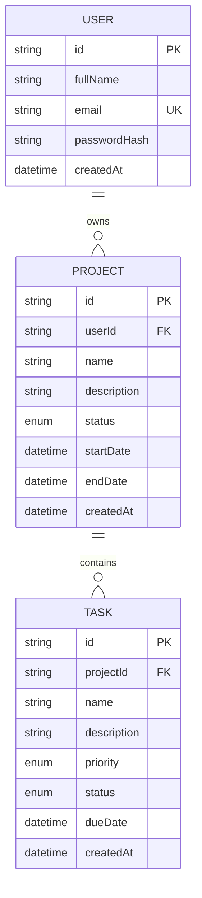

# TaskFlow — Project and task manager

TaskFlow is a full-stack project manager with a responsive React web app and an Android app built with Expo React Native. Both clients call the same Express REST API and PostgreSQL database. A user account and its projects/tasks are shared across platforms.

## Repository layout

```text
backend/   Express + TypeScript API, Prisma schema and migrations
web/       React + Vite responsive web application
mobile/    Expo React Native Android application
docker-compose.yml  Local PostgreSQL database
```

## Requirements

- Node.js 20 or newer and npm 10 or newer
- Docker Desktop (or a local PostgreSQL 14+ server)
- Expo Go on an Android device for development, or an Android emulator

## Run locally

1. Install dependencies from the repository root:

   ```sh
   npm install
   ```

2. Start PostgreSQL:

   ```sh
   docker compose up -d db
   ```

3. Configure the API. Copy `backend/.env.example` to `backend/.env`. Set a unique random `JWT_SECRET` of at least 32 characters. The example database URL is configured for the included compose service.

4. Generate the Prisma client and create the database tables:

   ```sh
   npm --workspace backend run db:generate
   npm --workspace backend run db:deploy
   ```

5. Start the API and web app in separate terminals:

   ```sh
   npm run dev:api
   npm run dev:web
   ```

   API: `http://localhost:4000` (health check: `/api/health`)  
   Web: `http://localhost:5173`

6. Set up the mobile app. Copy `mobile/.env.example` to `mobile/.env` if needed. The default `10.0.2.2` address reaches the host machine from the Android emulator. For a physical device, set `EXPO_PUBLIC_API_URL` to the computer's reachable LAN address, for example `http://192.168.1.24:4000/api`; ensure both devices are on the same network and the firewall allows port 4000. Then:

   ```sh
   npm run dev:mobile
   ```

   Scan the Expo QR code using Expo Go, or press `a` with an Android emulator running. Configure the web app and mobile app to use the same deployed API URL when testing cross-platform sync.

## Environment variables

| Variable | App | Required | Purpose |
| --- | --- | --- | --- |
| `DATABASE_URL` | Backend | Yes | PostgreSQL connection string |
| `JWT_SECRET` | Backend | Yes | Secret used to sign access tokens; use a long random value |
| `JWT_EXPIRES_IN` | Backend | No | JWT lifetime (`7d` by default) |
| `PORT` | Backend | No | API port (`4000` by default) |
| `WEB_ORIGIN` | Backend | No | Allowed web origin(s), comma-separated; defaults to local Vite origin |
| `VITE_API_URL` | Web | No | API base URL, defaults to `http://localhost:4000/api` |
| `EXPO_PUBLIC_API_URL` | Mobile | No | API base URL; defaults to Android emulator host mapping |

Do not commit real `.env` files or secrets. Set production values in the deployment platform's secret/environment settings.

## Database schema



The Prisma source of truth is [`backend/prisma/schema.prisma`](backend/prisma/schema.prisma), with the initial PostgreSQL migration checked into `backend/prisma/migrations/`. Projects belong to one user; tasks belong to one project. Foreign keys cascade on deletion. Passwords are stored as bcrypt hashes. Each task query checks the owning user through its project relationship.

## API documentation

All routes use the `/api` prefix. Protected routes require `Authorization: Bearer <token>`. JSON errors use `{ "error": "..." }`; validation errors also include field details. Dates are ISO 8601 strings or `null`. Enum values use uppercase underscore form.

### Authentication

| Method | Path | Body / result |
| --- | --- | --- |
| `POST` | `/auth/register` | `{ fullName, email, password }` → `{ token, user }` (201); duplicate email → 409 |
| `POST` | `/auth/login` | `{ email, password }` → `{ token, user }` |
| `POST` | `/auth/logout` | Protected; clients discard their token after success |
| `GET` | `/auth/me` | Protected; returns the current safe user profile |

Authentication endpoints are rate limited to 30 requests per IP per 15 minutes. Access tokens are JWTs; mobile tokens use Expo SecureStore (Android Keystore-backed storage). Logout is client-side token disposal because access JWTs are stateless; an already copied token remains valid until expiration.

### Projects

| Method | Path | Query/body |
| --- | --- | --- |
| `GET` | `/projects` | Optional `search`, `status`; includes tasks |
| `GET` | `/projects/:id` | One owned project and its tasks |
| `POST` | `/projects` | `{ name, description?, status?, startDate?, endDate? }` |
| `PUT` | `/projects/:id` | Any editable project fields |
| `DELETE` | `/projects/:id` | Deletes the project and its tasks; returns 204 |

Project statuses: `NOT_STARTED`, `IN_PROGRESS`, `COMPLETED`.

### Tasks

| Method | Path | Query/body |
| --- | --- | --- |
| `GET` | `/tasks` | Optional `search`, `projectId`, `status`, `priority` |
| `GET` | `/tasks/:id` | One task in a project owned by the caller |
| `POST` | `/tasks` | `{ projectId, name, description?, priority?, status?, dueDate? }` |
| `PUT` | `/tasks/:id` | Editable task fields; `projectId` may move it to another owned project |
| `DELETE` | `/tasks/:id` | Deletes one owned task; returns 204 |

Task statuses: `PENDING`, `IN_PROGRESS`, `COMPLETED`. Priorities: `LOW`, `MEDIUM`, `HIGH`.

### Dashboard and health

`GET /dashboard` returns `totalProjects`, `totalTasks`, `completedTasks`, `pendingTasks`, and `projectsInProgress` for the authenticated user. `GET /health` is a public API health check.

## Deployment

Deploy one PostgreSQL database and one instance of `backend` and configure `DATABASE_URL`, `JWT_SECRET`, `JWT_EXPIRES_IN`, `PORT`, and `WEB_ORIGIN`. Run `npm --workspace backend run db:deploy` as the release migration step. Deploy `web` as a static Vite site after setting `VITE_API_URL` to the deployed API's `/api` base URL. Set the API CORS origin to the web deployment's exact origin. Publish the mobile app with EAS Build or an Android build and configure `EXPO_PUBLIC_API_URL` to the same deployed API. The public deployment URL and APK are environment-specific deliverables and are not included in this local source workspace.

## Security and behavior notes

- Passwords are bcrypt-hashed; safe user selections omit password hashes.
- JWT middleware protects application endpoints; all project/task operations are scoped to the authenticated owner.
- Zod validates request bodies, dates, enums, email, and text sizes. Prisma uses parameterized ORM operations.
- Helmet headers, a JSON body size limit, authentication rate limiting, and environment-configured CORS are enabled.
- A 401 response clears the client session and directs the user back to sign in. Mobile shows a network message on connectivity failure and supports pull-to-refresh.
- The local sample database credentials are for development only. Use test accounts and test data.
